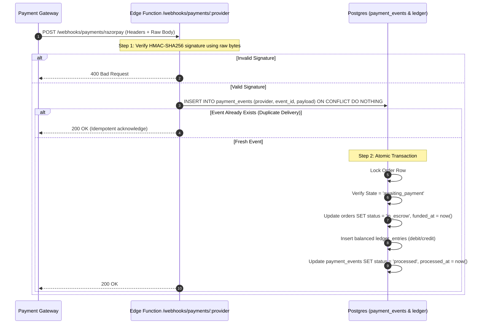

# Collivra Payment & Escrow Architecture Specification

> **Status:** Draft / Specification for Round 3 Implementation  
> **Document Purpose:** Complete architectural design for order cancellation, creator schema unification, append-only financial ledger, webhook verification, dispute handling, and tax compliance (TDS/GST).

---

## 1. Order Cancellation Design (`POST /orders/:id/cancel`)

### Problem Statement
With the database constraints introduced in Round 2 (`unique_order_per_bid` and `unique_active_order_per_campaign`), when a brand selects a bid via `POST /campaigns/:id/bids/:bidId/select` or creates a direct hire order via `POST /orders`, an order is created in `awaiting_payment`. If the brand decides not to proceed with funding, the campaign remains locked in `awarded`, rival bids remain `rejected`, and the partial unique index prevents any new bid selection.

### Endpoint Specification

| Attribute | Specification |
|-----------|---------------|
| **Method** | `POST` |
| **Path** | `/orders/:id/cancel` |
| **Auth** | Bearer Token (Brand Owner or Admin) |
| **Request Body** | `{ "reason": "optional explanation string" }` |
| **Responses** | `200 OK` (Order cancelled & campaign reopened)<br>`401 Unauthorized`<br>`403 Forbidden` (Creator calling brand endpoint)<br>`404 Not Found` (Order not found or belongs to another brand)<br>`409 Conflict` (Order not in `awaiting_payment`) |

### State Transitions & Database Logic
Cancellation prior to escrow funding must be atomic and execute in a single database transaction via `cancel_order_awaiting_payment(p_order_id, p_brand_id, p_reason)`:

1. **Lock Row:** `SELECT * FROM orders WHERE id = p_order_id FOR UPDATE;`
2. **Ownership Check:** Verify `orders.brand_id = p_brand_id` (or caller is admin). If mismatch, raise `404` to avoid leaking resource existence.
3. **State Guard:** Assert `orders.status = 'awaiting_payment'`. If `orders.status IN ('in_escrow', 'draft_submitted', 'changes_requested', 'released', 'completed', 'cancelled')`, raise error with code `P0007` (mapped to `409 Conflict`).
4. **Order Update:** Set `orders.status = 'cancelled'`, `orders.cancelled_at = clock_timestamp()`, `orders.cancellation_reason = p_reason`.
5. **Campaign Reopening (if campaign order):**
   - If `orders.campaign_id` is present:
     - Update `campaigns SET status = 'open_for_bids', updated_at = clock_timestamp() WHERE id = orders.campaign_id`.
     - Update winning bid: `campaign_bids SET status = 'submitted' WHERE id = orders.bid_id`.
     - Update rival bids that were rejected during bid selection: `campaign_bids SET status = 'submitted' WHERE campaign_id = orders.campaign_id AND status = 'rejected' AND id <> orders.bid_id`.
6. **Index Release:** Because `unique_active_order_per_campaign` filters `WHERE status != 'cancelled'`, setting status to `cancelled` automatically frees the unique partial index, allowing the brand to select another bid or close the campaign cleanly.

---

## 2. Section (a): Unifying Creators onto `creator_profiles`

### Current Schema Duplication
Currently, the codebase has two tables representing creator data:
- `creators`: Legacy standalone table keyed by text slug (`id text primary key`, e.g., `'ananya-rao'`).
- `creator_profiles`: Keyed by `user_id UUID REFERENCES auth.users(id)` and `profiles(id)`.

### Target Architecture
1. **Single Source of Truth:** `creator_profiles` becomes the sole table for all creator data.
2. **Schema Definition:**
   ```sql
   ALTER TABLE public.creator_profiles 
     ADD COLUMN IF NOT EXISTS slug TEXT NOT NULL UNIQUE,
     ADD COLUMN IF NOT EXISTS is_seed BOOLEAN NOT NULL DEFAULT FALSE,
     ADD COLUMN IF NOT EXISTS display_name TEXT,
     ADD COLUMN IF NOT EXISTS avatar_url TEXT,
     ADD COLUMN IF NOT EXISTS bio TEXT,
     ADD COLUMN IF NOT EXISTS categories TEXT[] DEFAULT '{}',
     ADD COLUMN IF NOT EXISTS city TEXT,
     ADD COLUMN IF NOT EXISTS starting_price_inr INTEGER,
     ADD COLUMN IF NOT EXISTS is_active BOOLEAN NOT NULL DEFAULT TRUE;
   ```
3. **Seed Creators as Flagged Real Accounts:**
   - Seed creators (`ananya-rao`, `rohan-verma`, `neha-sharma`) will be provisioned as real accounts in `auth.users` with `is_seed = true`.
   - Their slugs match their legacy IDs (`ananya-rao`, etc.) to preserve existing frontend URLs and deep links.
4. **Foreign Key Migration Plan:**
   - `campaign_bids.creator_id` -> foreign key to `creator_profiles(user_id)`.
   - `orders.creator_id` -> foreign key to `creator_profiles(user_id)`.
   - `cart_items.creator_id` -> foreign key to `creator_profiles(user_id)`.
   - `shortlist_creators.creator_id` -> foreign key to `creator_profiles(user_id)`.
5. **Zero-Downtime Migration Steps:**
   - **Step 1:** Backfill existing `creators` rows into `auth.users` and `creator_profiles`, preserving slugs.
   - **Step 2:** Add UUID columns `creator_user_id` alongside existing `creator_id` in `orders`, `campaign_bids`, and `cart_items`.
   - **Step 3:** Dual-write in Edge Function `api` while backfilling historical records.
   - **Step 4:** Swap foreign key constraints to `creator_profiles(user_id)`.
   - **Step 5:** Drop legacy `creators` table.

---

## 3. Section (b): Append-Only Financial Ledger & Idempotency

### Double-Entry Ledger Principles
To ensure complete financial auditability and avoid escrow drift, all monetary movements must follow double-entry bookkeeping rules:
- **Integer Paise Representation:** All monetary fields stored strictly as `BIGINT` representing Indian Paise (1 INR = 100 Paise). Floating point arithmetic is strictly forbidden.
- **Append-Only Immutability:** `UPDATE` and `DELETE` privileges are revoked on `ledger_entries`. Corrections are made exclusively via new compensating debit/credit entries.

### Schema: `ledger_entries`
```sql
CREATE TABLE public.ledger_entries (
  id UUID PRIMARY KEY DEFAULT gen_random_uuid(),
  order_id UUID NOT NULL REFERENCES public.orders(id),
  account TEXT NOT NULL CHECK (account IN (
    'brand_funds_received',
    'escrow_liability',
    'platform_fee_revenue',
    'platform_gst_payable',
    'creator_payable',
    'tds_withholding_payable'
  )),
  direction TEXT NOT NULL CHECK (direction IN ('debit', 'credit')),
  amount_paise BIGINT NOT NULL CHECK (amount_paise > 0),
  idempotency_key TEXT NOT NULL UNIQUE,
  reference_event_id TEXT,
  metadata JSONB NOT NULL DEFAULT '{}'::jsonb,
  created_at TIMESTAMPTZ NOT NULL DEFAULT clock_timestamp()
);

-- Revoke mutation rights
REVOKE UPDATE, DELETE ON public.ledger_entries FROM PUBLIC, anon, authenticated, service_role;
```

### Schema: `payment_events` (Webhook Event Inbox)
```sql
CREATE TABLE public.payment_events (
  id UUID PRIMARY KEY DEFAULT gen_random_uuid(),
  provider TEXT NOT NULL CHECK (provider IN ('razorpay', 'cashfree', 'stripe')),
  event_id TEXT NOT NULL,
  event_type TEXT NOT NULL,
  payload JSONB NOT NULL,
  status TEXT NOT NULL DEFAULT 'pending' CHECK (status IN ('pending', 'processed', 'ignored', 'failed')),
  error_message TEXT,
  processed_at TIMESTAMPTZ,
  created_at TIMESTAMPTZ NOT NULL DEFAULT clock_timestamp(),
  CONSTRAINT unique_provider_event UNIQUE (provider, event_id)
);
```

---

## 4. Section (c): Payment Gateway Webhook Flow & Signature Verification

### Webhook Handling Pipeline



### Signature Verification Guidelines
- Webhook signature verification **must** use raw request body bytes prior to JSON decoding to avoid whitespace/key-sorting tampering.
- Secrets (`RAZORPAY_WEBHOOK_SECRET`) must be retrieved securely from vault/environment and never logged.
- The webhook handler must return `200 OK` within 3 seconds; background jobs or immediate transactional updates guarantee gateway retry prevention.

---

## 5. Section (d): Refund and Dispute Endpoints Design

### 1. Brand/Admin Refund (`POST /orders/:id/refund`)
- **Allowed States:** `in_escrow`, `changes_requested`.
- **Preconditions:** Work not approved or released.
- **Actions:**
  - Initiates payment gateway refund API call with unique idempotency key.
  - Appends reverse entries in `ledger_entries` (debit `escrow_liability`, credit `brand_funds_received`).
  - Updates `orders.status = 'cancelled'`.

### 2. Escrow Dispute Flow (`POST /orders/:id/dispute`)
- **Allowed States:** `draft_submitted`, `changes_requested` (e.g. brand requests 3rd revision, or creator refuses revision).
- **Actions:**
  - Transitions order to `in_dispute`.
  - Escrow release and automated timers are immediately frozen.
  - Creates ticket in internal dispute management dashboard with snapshot of deliverable drafts, change notes, and chat transcripts.
- **Admin Resolution Endpoint (`POST /admin/orders/:id/resolve-dispute`):**
  - Accepts resolution option:
    1. `full_refund`: Escrow returned to brand.
    2. `full_release`: Escrow released to creator.
    3. `split`: Custom percentage split between brand and creator.
  - Generates immutable balancing entries in `ledger_entries` matching the resolution.

---

## 6. Section (e): Tax Snapshots Stored on Order at Creation

### Indian Regulatory Framework
1. **Section 194-O of the Income Tax Act:** E-commerce operators are mandated to deduct TDS @ 1% on the gross amount of sales of goods/services facilitated through the platform for Indian tax residents with valid PAN (5% for invalid/missing PAN).
2. **Goods and Services Tax (GST):** 18% GST applies to platform service commission fees.

### Frozen Order Snapshot Columns
Tax rates and platform commission percentages must never fluctuate retroactively for existing contracts. At the moment an order is created (in `awaiting_payment`), the following exact amounts are computed and permanently stored:

| Column | Type | Description |
|--------|------|-------------|
| `amount` | `BIGINT` | Total contract value in Paise (e.g. 1000000 = ₹10,000) |
| `platform_fee_bps` | `INTEGER` | Platform commission rate in basis points (1000 bps = 10.00%) |
| `platform_fee_paise` | `BIGINT` | Commission amount: ₹1,000 (100000 paise) |
| `platform_fee_gst_paise` | `BIGINT` | 18% GST on platform commission: ₹180 (18000 paise) |
| `tds_rate_bps` | `INTEGER` | 100 bps (1%) with verified PAN, or 500 bps (5%) without PAN |
| `tds_amount_paise` | `BIGINT` | 1% of gross contract value: ₹100 (10000 paise) |
| `creator_net_paise` | `BIGINT` | Final payout amount to creator: `amount - platform_fee - gst - tds` |

---

## 7. Open Decisions Needed

Before starting Round 3 implementation, the following decisions are required from stakeholders:

1. **Payment Gateway Provider Selection:**
   - *Option A:* Razorpay (Industry standard in India, native Route/Virtual Account support for marketplace splits).
   - *Option B:* Cashfree Payments (Low marketplace fees, robust Payouts API).
2. **Escrow / Flow of Funds Structure:**
   - *Nodal Account / Escrow Partner:* Required for holding funds for > T+2 days under RBI E-Commerce Guidelines.
   - *Automated Marketplace Routing:* PG automatically splits funds to creator upon brand approval.
3. **Auto-Approval Inactivity SLA:**
   - Number of days after draft submission before an order is automatically approved if the brand takes no action (Recommended: 7 calendar days).
4. **GST Invoicing Requirements:**
   - Whether Collivra generates automated GST Tax Invoices on behalf of registered creators, or only invoices for its own platform commission fee.
